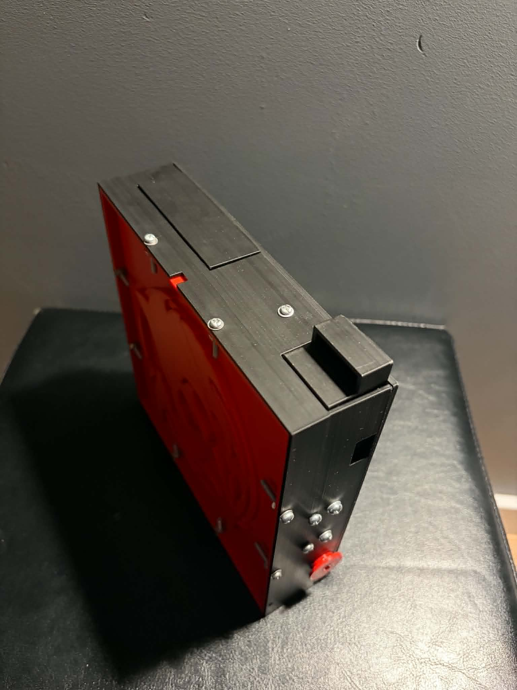
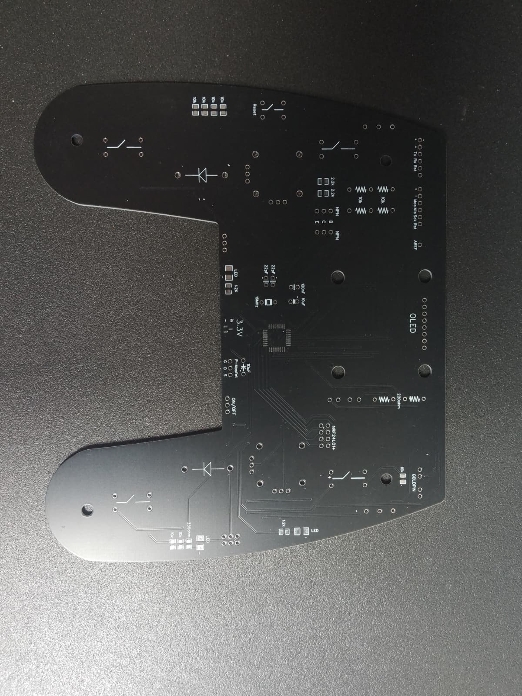

# Minor Hobby Projects Portfolio
A collection of some of my small hobby projects. Their scope is too little for a separate repository, but they still stand as a sincere tribute to my lifetime passion for creation.

## Table of contents
* [RC Car Powertrain](#rc-car-powertrain)
* [Puzzle Box](#puzzle-box)
* [Piano Music Box](#piano-music-box)
* [RC Transceiver](#rc-transceiver)
* [Other](#other)

## RC Car Powertrain
A drive system for an RC car that consists of a custom 3D printed frame, two brushless motors, metal shafts, a differential, shock absorbers, and custom wheel hubs. It took a lot of prototyping to get the parts to work together smoothly.

Development time: from 07.2023 to 09.2023.

I abandoned the project when I started university because I took on more important tasks.

 
<em>Powertrain and suspension.</em>

 
<em>Side view and a close-up on the wheel hub.</em>

## Puzzle Box
A 3D-printed puzzle box that I created as a gift for my friend's birthday. It requires solving 6 small riddles to open a secret container with a key to another part of the gift. The box hides a few neat mechanisms utilizing metal balls to manipulate levers and latches.

Development time: from 07.2022 to 09.2022.

   
  <em>Puzzle box top view.</em>

  
   
  <em>Puzzle box side views.</em>

## Piano Music Box
Another birthday gift project: this time a 3D-printed piano with a music box inside. Fits neatly on a musician's shelf.

Development time: 04.2023.

(Picture not available at the moment.)

## RC Transceiver
My first ever PCB project. It is an early prototype for a much more polished version available [here](https://github.com/A-Rozmarynowicz/Custom_RC_Transceiver). Based on the ATmega328 IC and the nRF24L01+ transceiver, it includes a power converter, two joysticks, a few pushbuttons, and LEDs. Compatible with my RC vehicles ([drift car](https://github.com/A-Rozmarynowicz/RC_Drift_Car) and [off-road car](https://github.com/A-Rozmarynowicz/RC_Off-Road_Car)).

Development time: year 2021

   
  <em>RC transceiver PCB.</em>

## Other
I have worked on multiple other projects that are either disassembled or never documented. These projects included:
- a drone prototype, developed before I had any idea about how a quadcopter should be done,
- a controller for a tractor's air conditioning
- multiple small projects in embedded systems and electronics, like motor drivers or communication systems,
- following [Ben Eater's](https://www.youtube.com/BenEater) YouTube tutorials on building  an 8-bit computer from scratch,
- an AC rectifier,
- and more.

I have fostered my curiosity and passion for learning for many years, and I am eager to utilize them in professional work.