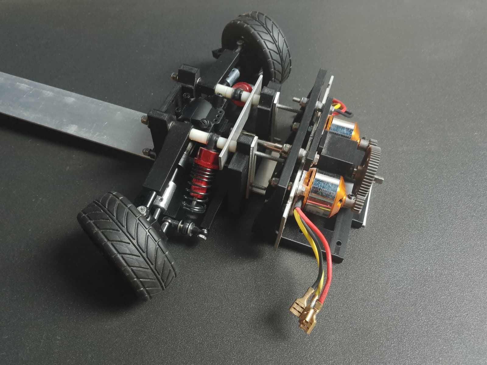
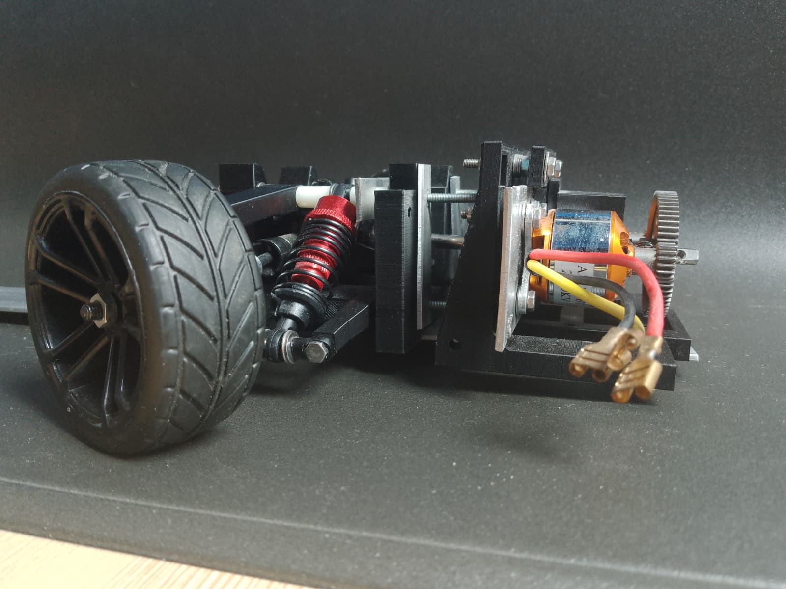
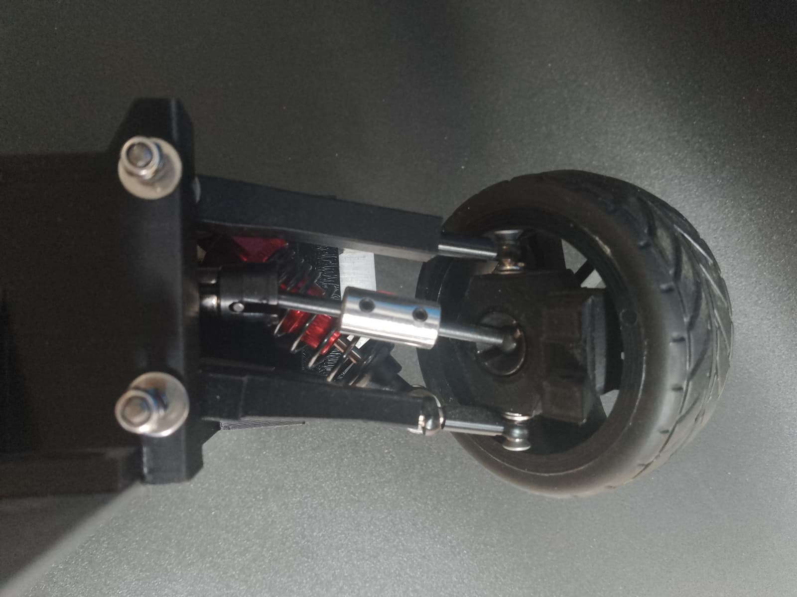
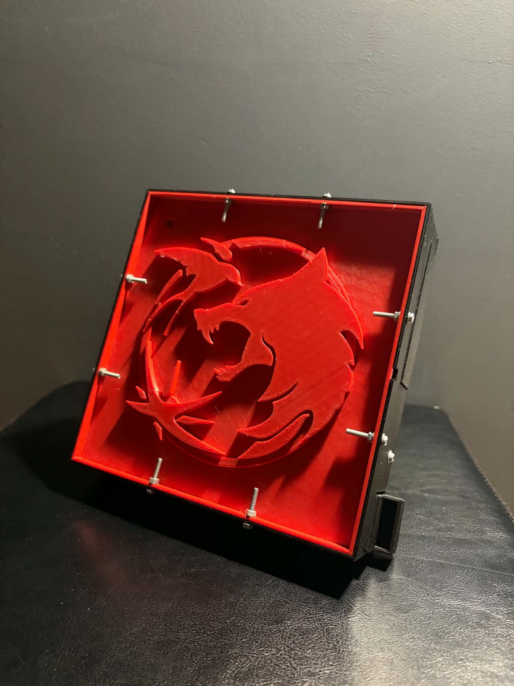
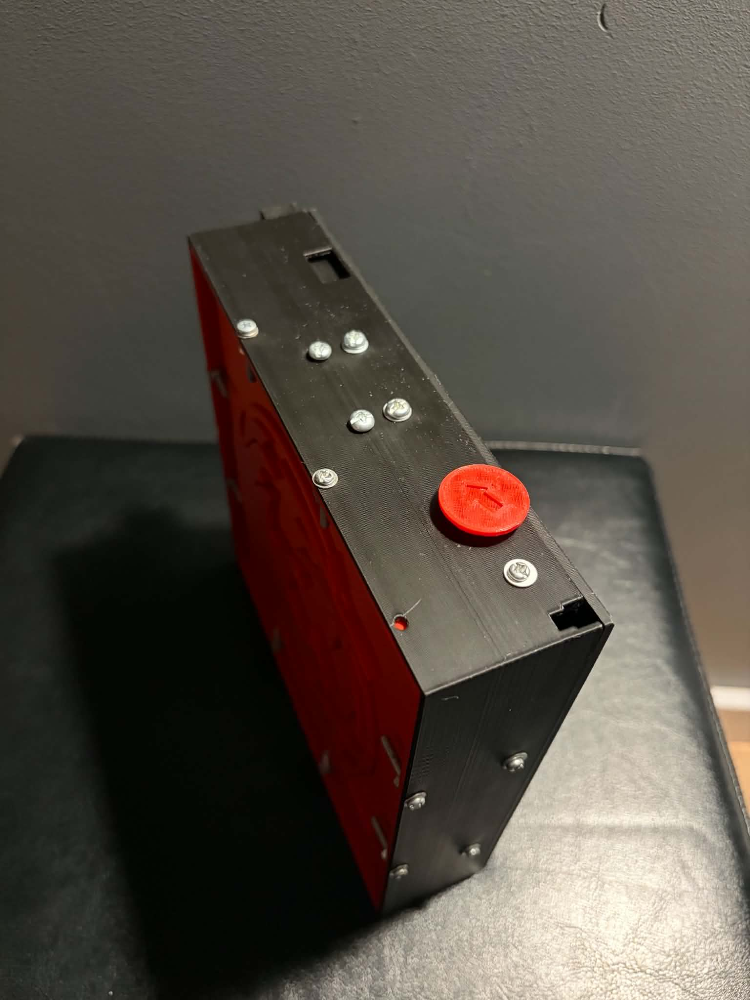

# Minor Hobby Projects Portfolio
Collection of some of my small hobby projects. Their scope is too little for a separate repository, but they still stand as a sincere tribute to my lifetime passion for creation.

## Table of contents
* [RC Car Powertrain](#rc-car-powertrain)
* [Puzzle Box](#puzzle-box)
* [RC Transceiver](#rc-transceiver)
* [Piano Music Box](#piano-music-box)

## RC Car Powertrain
In the [RC_Car_Powertrain/](./RC_Car_Powertrain/) folder you can see a drive system for an RC car. It consists of a custom 3D printed frame, two brushless motors, metal shafts, a differential, shock absorbers, custom wheel hubs. It took a lot of prototyping to get the parts work together smoothly.

I abandoned the project when I started the University, as I picked up more important tasks.

 
<em>Powertrain and suspension.</em>

 
<em>Side view and a close-up on the wheel hub.</em>

## Puzzle Box
In the [Puzzle_Box/](./Puzzle_Box/) folder there's a showcase of a 3D-printed puzzle box that I created as a gift for my friend's birthday. It requires solving 6 small riddles to open a secret container with a key to another part of the gift. The box hides a few neat mechanisms utilizing metal balls to manipulate levers and latches.

   
  <em>Puzzle box top view.</em>

  
   
  <em>Puzzle box side views.</em>

## RC Transceiver
In the [RC_Transceiver/](./RC_Transceiver/) folder you can see my first ever PCB project. It is an early prototype for a much more polished version available [here](https://github.com/A-Rozmarynowicz/Custom_RC_Transceiver). Based on the ATmega328 IC and the nRF24L01+ transceiver, it includes a power converter, two joysticks, a few pushbuttons and LEDs. Compatible with my RC vehicles ([drift car](https://github.com/A-Rozmarynowicz/RC_Drift_Car) and [off-road car](https://github.com/A-Rozmarynowicz/RC_Off-Road_Car)).

## Piano Music Box
In the [Piano_Music_Box/](./Piano_Music_Box/) there is another birthday gift project, this time a 3D-printed piano with a music box inside. Fits neatly on a musician's shelf.

